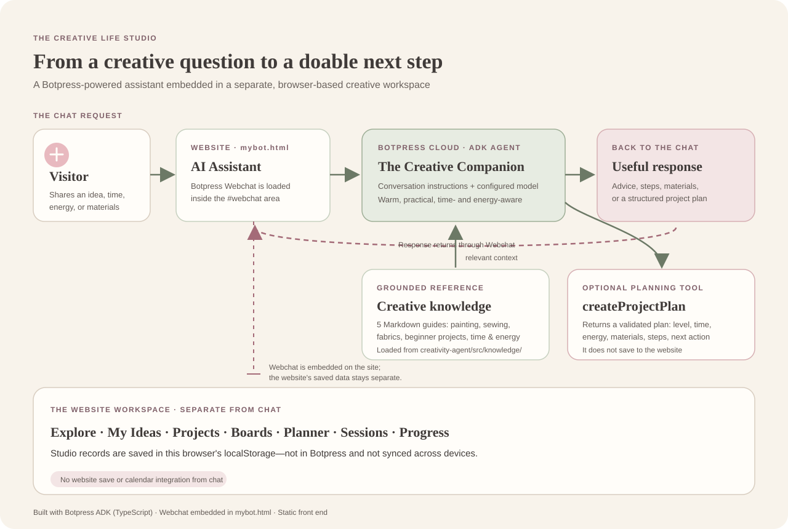

# The Creative Life Studio: 2-minute demo

## How it works

The Creative Life Studio is a static HTML/CSS/JavaScript website. Its AI Assistant area embeds Botpress Webchat. The chat sends messages to **The Creative Companion**, a TypeScript agent built with the Botpress ADK and deployed to Botpress Cloud.

The agent follows its conversation instructions, can consult the configured creative reference knowledge base, and can call `createProjectPlan` to return a structured plan. The tool validates and returns a plan; it does not save it anywhere.

The knowledge base is configured to read every Markdown file in `creativity-agent/src/knowledge/`:

- `painting-fundamentals.md` — paint basics, color mixing, and approachable exercises
- `beginner-sewing-and-safety.md` — sewing terms, beginner practice, and tool safety
- `fabric-coordination.md` — color, pattern, and practical material compatibility
- `beginner-project-library.md` — example painting, sewing, and DIY projects
- `time-and-energy-planning.md` — realistic 5/15/30/60-minute ideas and energy-aware planning

The website's ideas, projects, inspiration boards, and planned sessions are stored in that browser's `localStorage`. That storage is **not connected to the chatbot** and does not sync across devices. The agent has no configured persistent bot or user state.

## Two-minute talk track

**0:00–0:25 | Introduce the website**

> “The Creative Life Studio helps people turn creative inspiration into a manageable next step. You can explore ideas, organize projects, and plan around the time and energy you actually have.”

Show the Home page, then briefly point to **My Ideas** or the **Creative Planner**.

**0:25–1:20 | Demonstrate the assistant**

Open **AI Assistant** and send the sample prompt below. Point out how the answer can use the user's skill level, time, energy, and materials to shape its recommendation.

**1:20–1:40 | Show a follow-up**

Ask the follow-up prompt below to show the conversation can build on what the user just said. Mention that the plan is advice to copy into the site—not an automatic save.

**1:40–2:00 | Explain the connection**

> “The assistant runs in Botpress Cloud. Its creative references and project-planning capability help shape the response. The website is a separate lightweight front end: saved studio information stays in this browser, and chat does not write to it.”

Use the diagram to point out the message path and the separate local storage.

## Sample prompts

### Main demo prompt

> I'm a beginner with low energy and 15 minutes. I have watercolor paper, a brush, and two paints. Give me one activity that fits, with materials, a few steps, and one small next action.

This is a good live prompt because it demonstrates personalization and time-aware creative guidance without needing a long setup.

### Follow-up

> Can you make that work as a 5-minute first step, and suggest two colors to try?

### Backup prompts

- **Show fabric knowledge:** “I have a sage floral and cream cotton. Could they work together for a pouch? Explain visual coordination versus practical fabric suitability.”
- **Show a structured project plan:** “Plan a beginner felt bookmark project. Include materials, realistic active time, three steps, and the easiest first action.”
- **Show tool boundaries:** “Can you save this plan to My Ideas?” The assistant should explain that it cannot save to the website and offer a plan the user can copy.

## How it is set up

1. The TypeScript agent is defined in `creativity-agent/`, with its persona and model configuration in `agent.config.ts`.
2. The conversation instructions and enabled knowledge/tool are wired in `src/conversations/index.ts`.
3. `src/knowledge/index.ts` loads the Markdown references from `src/knowledge/`.
4. `src/actions/index.ts` defines the structured `createProjectPlan` tool.
5. The deployed agent is embedded in `mybot.html` using Botpress's Webchat loader, a `#webchat` container, and `window.botpress.init(...)`.
6. The website stores its own studio data locally in the browser; it has no backend connection to the agent.

For a live demo, open the deployed website, navigate to **AI Assistant**, and paste the main prompt. Keep the backup prompts handy in case the first response is unusually slow or vague.
